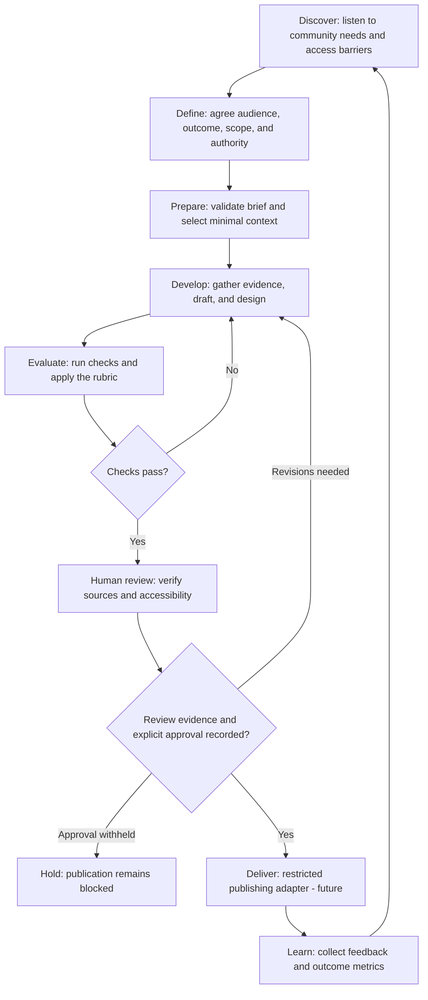
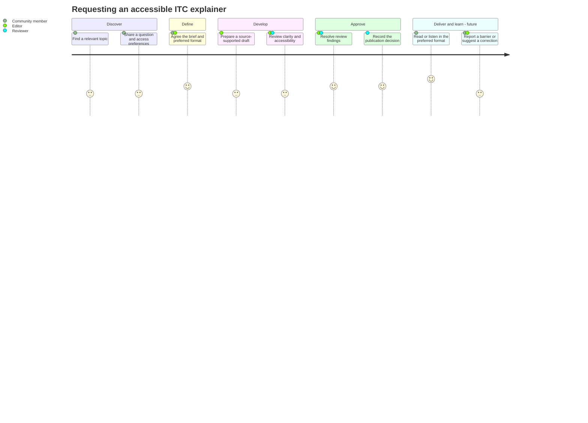

# ITC Inclusive Intelligence Factory · v0.1

A runnable, dependency-free **reference scaffold** for an inclusive multi-agent editorial workflow. Inspired by the modular `agents / skills / workflows` structure of [tarekcxl/ai-seo-system](https://github.com/tarekcxl/ai-seo-system), but independently authored for Inclusive Tech Club.

## Why this exists

AI-generated outputs can be variable. **Governance doesn't have to be.** The system separates probabilistic content creation from deterministic permission checks, validation, and human publication approval. Accessibility, factual integrity and human agency are product requirements, not post-production decoration.

## What works in v0.1

- Command-line demonstration: `python -m itc_factory.demo` from inside `src` (see exact command below).
- Task context schema validation using Python's standard library (small subset of required fields, with JSON Schema for integration).
- Context selection with task-specific minimization and no private personal records in the output bundle.
- Draft evaluation for missing source support, missing alt-text, human approval and structured output.
- Structured handoff data and a human approval gate.
- Automated unit tests with `python -m unittest discover -s tests -v`.

**Not implemented:** actual LLM providers, live source retrieval, automated visual accessibility scanning, secure distributed authorization, CMS publishing, or real self-improvement. The demo deliberately does not pretend to verify factual claims. Human review is required. Do not use it as a production security boundary.

## Quick start

Requires Python 3.10+; no packages to install.

```bash
cd itc-inclusive-intelligence
PYTHONPATH=src python -m itc_factory.demo
PYTHONPATH=src python -m unittest discover -s tests -v
```

PowerShell:

```powershell
$env:PYTHONPATH="src"
python -m itc_factory.demo
python -m unittest discover -s tests -v
```

This prints an evaluation report and saves a demonstration packet under `workflows/output/`. Publication remains blocked unless both independent review evidence and explicit approval are provided.

## Directory structure

- `CLAUDE.md`: project policy and development instructions
- `agents/`: agent responsibilities, tool limits, and handoff contracts
- `skills/`: reusable focused skill instructions
- `context/`: governance principles, inclusion requirements, and design evolution notes
- `schemas/`: JSON Schema contracts for task input and handoff
- `src/itc_factory/`: runnable illustrative orchestration
- `evaluations/`: scoring rubrics and test cases
- `tests/`: executable checks
- `workflows/`: workflow specifications and generated local outputs
- `examples/`: sample task

## Architecture

`Task → context selection → research packet → editorial draft → evaluation → human review → approved publishing adapter (future)`

**Human approval is not the same as automated evaluation.** Automated checks can flag issues and block missing requirements; editorial judgment, lived-experience review and source verification remain necessary.

## Service design workflow

This proposed service workflow connects community needs, editorial delivery, and learning. It describes the intended service beyond the v0.1 demo: research and drafting currently use fixtures, human review is still required, and publishing is a future integration.



**Text equivalent:** Discover community needs, define the service outcome, validate the brief, and prepare content with relevant context. Failed checks or requested revisions return to development. Publication stays blocked without human review evidence and explicit approval. After future delivery, feedback informs the next brief.

## Community member journey

This illustrative journey follows a community member requesting an accessible explainer. Satisfaction scores are design hypotheses on a 1–5 scale, not measured research findings. Delivery and feedback stages describe the future service.



**Text equivalent:** The member finds a topic, shares a question and access preferences, and agrees a brief with an editor. The editor prepares the draft; a human reviewer checks it and records a publication decision. In the future service, the member receives an approved explainer in their preferred format and can report barriers or corrections.

Use interviews and accessibility review to validate this journey before treating it as evidence. Track clarity of the brief, review turnaround, access barriers, and whether members can use the final content.

## First pilot metrics

Source-backed claim rate, critical accessibility defects, time spent correcting drafts, editorial consistency, task success, and run cost. Compare baseline and new workflow using the same briefs and reviewer rubric.

## Reuse and provenance

The reference repository's architecture inspired the directory naming and modular approach; no files from that repository were copied. Do not infer a license grant for upstream code. This scaffold is independently authored and can be adapted by ITC. Add a license only after choosing appropriate publication terms.
